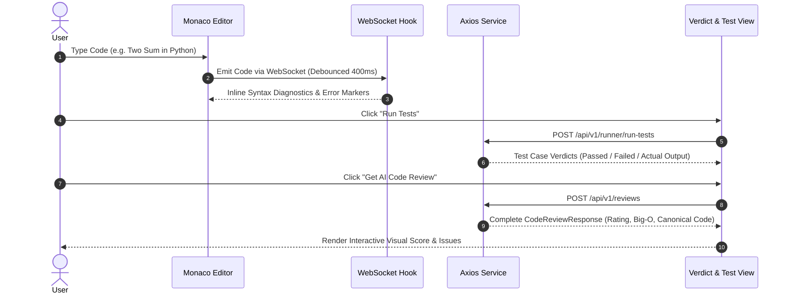

# 🚀 PyCodeReview AI: Intelligent Multi-Language Code Reviewer & Sandbox

[](https://fastapi.tiangolo.com)
[](https://ai.google.dev)
[](https://tree-sitter.github.io)
[](https://react.dev)
[](https://microsoft.github.io/monaco-editor/)
[](https://beanie-odm.dev)

An enterprise-grade, asynchronous AI-driven code analysis, static linting, and automated test-execution platform. Built with a high-performance **Python 3.11+ / FastAPI** engine, **Google Gemini 2.5 Flash** structured outputs, **Tree-Sitter** multi-language AST parser, a secure **sandboxed runner**, and a modern **React + Monaco Editor** client.

---

## 📑 Table of Contents
1. [System Architecture](#-system-architecture)
2. [Monorepo Directory Layout](#-monorepo-directory-layout)
3. [Backend Specification (`/backend`)](#-backend-specification-backend)
   - [Tech Stack & Dependencies](#backend-tech-stack--dependencies)
   - [Pydantic Schemas & Data Contracts](#pydantic-schemas--data-contracts)
   - [Google Gemini 2.5 Flash Engine](#google-gemini-25-flash-engine)
   - [Tree-Sitter AST & Static Analysis](#tree-sitter-ast--static-analysis)
   - [Sandboxed Test Runner](#sandboxed-test-runner)
   - [WebSocket Live Analysis](#websocket-live-analysis)
   - [Database Persistence (Beanie ODM)](#database-persistence-beanie-odm)
4. [Frontend Specification (`/frontend`)](#-frontend-specification-frontend)
   - [Tech Stack & Libraries](#frontend-tech-stack--libraries)
   - [Architecture & State Flow](#frontend-architecture--state-flow)
   - [Core UI Components](#core-ui-components)
5. [End-to-End API Contracts](#-end-to-end-api-contracts)
6. [Step-by-Step Implementation Roadmap](#-step-by-step-implementation-roadmap)
7. [Environment Setup & Quickstart](#-environment-setup--quickstart)
8. [Docker Compose & Deployment](#-docker-compose--deployment)

---

## 🏗️ System Architecture

```mermaid
flowchart TD
    subgraph Client ["Client Layer (React + Monaco)"]
        UI[User / React Frontend]
        Editor[Monaco Code Editor]
        TestCaseUI[Test Case Runner UI]
        VerdictUI[Verdict & Review Dashboard]
    end

    subgraph Gateway ["API Gateway (FastAPI)"]
        Router[FastAPI Router /api/v1]
        WS[WebSocket Manager /ws]
        CORS[CORS & Security Middleware]
    end

    subgraph Engine ["Python AI & Analysis Engine"]
        AST[Tree-Sitter AST Parser<br/>(C, C++, Java, Py, JS)]
        Static[Static Analyzer<br/>(Radon Complexity & Ruff)]
        Runner[Isolated Sandboxed Runner<br/>(Subprocess / TLE / Memory limits)]
        Gemini[Google Gemini 2.5 Flash<br/>(Structured Pydantic Schema)]
        Aggregator[Verdict & Metrics Aggregator]
    end

    subgraph Storage ["Persistence Layer"]
        DB[(MongoDB via Beanie ODM)]
    end

    UI -->|Code Edit (Debounced 500ms)| WS
    WS -->|Live Syntax & AST Warnings| Editor
    
    UI -->|POST /api/v1/run-tests| Router
    Router --> Runner
    Runner -->|Stdout, Stderr, TLE Verdict| TestCaseUI

    UI -->|POST /api/v1/reviews| Router
    Router --> AST
    Router --> Static
    Router --> Runner
    AST --> Aggregator
    Static --> Aggregator
    Runner --> Aggregator
    Aggregator --> Gemini
    Gemini -->|Strict JSON| Aggregator
    Aggregator --> DB
    Aggregator -->|Verdict JSON| VerdictUI
```

---

## 📁 Monorepo Directory Layout

```text
Major_1_2/
├── backend/
│   ├── app/
│   │   ├── __init__.py
│   │   ├── main.py                     # FastAPI app factory, middleware & lifespan
│   │   ├── config.py                   # Pydantic BaseSettings & env configs
│   │   ├── api/
│   │   │   ├── __init__.py
│   │   │   ├── deps.py                 # Dependency injection (Auth, DB session)
│   │   │   └── v1/
│   │   │       ├── __init__.py
│   │   │       ├── router.py           # V1 API aggregator
│   │   │       ├── reviews.py          # POST /reviews, GET /reviews/{id}
│   │   │       ├── runner.py           # POST /run-tests
│   │   │       └── websocket.py        # WS /ws/realtime-analysis
│   │   ├── core/
│   │   │   ├── __init__.py
│   │   │   ├── gemini.py               # Google GenAI 2.5 client & structured prompt
│   │   │   ├── ast_parser.py           # Tree-sitter multi-language parser
│   │   │   ├── static_analyzer.py      # Radon cyclomatic complexity & linter
│   │   │   └── test_runner.py          # Subprocess sandboxed execution engine
│   │   ├── models/
│   │   │   ├── __init__.py
│   │   │   ├── user.py                 # Beanie user document
│   │   │   └── review.py               # Beanie review document (history & stats)
│   │   ├── schemas/
│   │   │   ├── __init__.py
│   │   │   ├── review.py               # Pydantic request & structured response
│   │   │   └── test_case.py            # Test execution schemas
│   │   └── utils/
│   │       ├── __init__.py
│   │       └── normalizer.py           # String output normalization & diff engine
│   ├── tests/
│   │   ├── conftest.py
│   │   ├── test_ast.py
│   │   ├── test_runner.py
│   │   └── test_gemini.py
│   ├── .env.example
│   ├── Dockerfile
│   └── requirements.txt
│
├── frontend/
│   ├── public/
│   ├── src/
│   │   ├── assets/
│   │   ├── components/
│   │   │   ├── Navbar.jsx              # App header with language selector & theme toggle
│   │   │   ├── CodeEditor.jsx          # Monaco Editor wrapper with WebSocket diagnostics
│   │   │   ├── TestCaseRunner.jsx      # Test runner panel with custom input & results
│   │   │   ├── VerdictView.jsx         # Review score, Big-O comparison & recommendations
│   │   │   ├── ComplexityCard.jsx      # Visual Time/Space complexity badge comparison
│   │   │   └── IssueList.jsx           # Line-by-line syntax & performance warnings
│   │   ├── hooks/
│   │   │   ├── useWebSocket.js         # Reconnecting WebSocket client for live linting
│   │   │   └── useDebounce.js          # Input debouncing hook
│   │   ├── services/
│   │   │   └── api.js                  # Axios client configured with base URL
│   │   ├── App.jsx                     # Root application layout
│   │   ├── main.jsx                    # React entrypoint
│   │   └── index.css                   # Global design tokens and styling
│   ├── package.json
│   ├── vite.config.js
│   └── .env.example
│
├── docker-compose.yml                  # Full stack local orchestration
└── README.md                           # Master Project Blueprint
```

---

## ⚙️ Backend Specification (`/backend`)

### Backend Tech Stack & Dependencies

```ini
# Core Framework & Settings
fastapi>=0.110.0
uvicorn[standard]>=0.28.0
pydantic>=2.6.0
pydantic-settings>=2.2.0

# AI & LLM Engine
google-genai>=2.17.1

# AST & Static Code Parsing
tree-sitter>=0.22.0
tree-sitter-languages>=1.10.2

# Code Metrics & Quality
radon>=6.0.1
ruff>=0.3.0
bandit>=1.7.8

# Database (Async MongoDB)
motor>=3.3.2
beanie>=1.25.0

# Async System & Utilities
aiofiles>=23.2.1
python-dotenv>=1.0.1
pytest>=8.0.0
pytest-asyncio>=0.23.5
httpx>=0.27.0
```

---

### Pydantic Schemas & Data Contracts

Located at `app/schemas/review.py`. Uses `Field(alias="camelCase")` and `populate_by_name=True` to guarantee seamless compatibility with JavaScript/React frontend naming conventions.

```python
from pydantic import BaseModel, ConfigDict, Field
from typing import List, Optional

class TestCaseInput(BaseModel):
    input: str
    expected_output: str = Field(alias="expectedOutput")

class TestCaseResult(BaseModel):
    model_config = ConfigDict(populate_by_name=True)
    
    input: str
    expected_output: str = Field(alias="expectedOutput")
    actual_output: str = Field(alias="actualOutput")
    passed: bool
    execution_time_ms: Optional[float] = Field(None, alias="executionTimeMs")
    explanation: Optional[str] = None

class ComplexityComparison(BaseModel):
    model_config = ConfigDict(populate_by_name=True)
    
    user_time: str = Field(alias="userTime", description="e.g. O(N^2)")
    optimal_time: str = Field(alias="optimalTime", description="e.g. O(N log N)")
    user_space: str = Field(alias="userSpace", description="e.g. O(1)")
    optimal_space: str = Field(alias="optimalSpace", description="e.g. O(N)")

class DetectedIssue(BaseModel):
    model_config = ConfigDict(populate_by_name=True)
    
    line: Optional[int] = None
    severity: str = Field(description="Critical | Warning | Info")
    message: str
    suggested_fix: Optional[str] = Field(None, alias="suggestedFix")

class CodeReviewRequest(BaseModel):
    code: str
    language: str
    problem_title: Optional[str] = Field(None, alias="problemTitle")
    problem_description: Optional[str] = Field(None, alias="problemDescription")
    test_cases: List[TestCaseInput] = Field(default=[], alias="testCases")

class CodeReviewResponse(BaseModel):
    model_config = ConfigDict(populate_by_name=True)

    summary: str
    rating: int = Field(ge=0, le=100, description="Overall code rating from 0 to 100")
    verdict: str = Field(description="Accepted | Wrong Answer | Needs Improvement | Time Limit Exceeded")
    algorithmic_approach: str = Field(alias="algorithmicApproach", description="e.g. Two Pointers, Dynamic Programming")
    correct_code: str = Field(alias="correctCode", description="Optimal canonical reference implementation")
    optimal_explanation: str = Field(alias="optimalExplanation")
    complexity_comparison: ComplexityComparison = Field(alias="complexityComparison")
    test_case_results: List[TestCaseResult] = Field(default=[], alias="testCaseResults")
    issues: List[DetectedIssue] = Field(default=[])
    ast_metrics: Optional[dict] = Field(default=None, alias="astMetrics")
```

---

### Google Gemini 2.5 Flash Engine

Located at `app/core/gemini.py`. Uses `google-genai` SDK with strict JSON response schema generation.

```python
import json
from google import genai
from google.genai import types
from app.config import settings
from app.schemas.review import CodeReviewResponse

client = genai.Client(api_key=settings.GEMINI_API_KEY)

SYSTEM_PROMPT = """
You are a Principal Software Engineer and Competitive Programming Algorithm Specialist.
Analyze the user's code submission with meticulous precision:
1. Identify the algorithmic approach and evaluate edge-case correctness.
2. Provide canonical, optimal reference code in the matching programming language.
3. Quantify Time and Space complexity for both the user's solution and optimal approach.
4. Highlight line-by-line defects, code smells, or security antipatterns.
5. Strictly adhere to the requested JSON response schema.
"""

async def review_code_with_gemini(
    code: str,
    language: str,
    problem_title: str | None = None,
    problem_description: str | None = None,
    ast_summary: dict | None = None,
    test_results: list | None = None
) -> CodeReviewResponse:
    prompt = f"### Target Language: {language}\n\n### User Code Submission:\n```{language}\n{code}\n```\n"
    
    if problem_title:
        prompt += f"\n### Problem: {problem_title}\n{problem_description or ''}\n"
        
    if ast_summary:
        prompt += f"\n### Static AST Pre-Analysis Metrics:\n{json.dumps(ast_summary, indent=2)}\n"
        
    if test_results:
        prompt += f"\n### Test Case Execution Summary:\n{json.dumps(test_results, indent=2)}\n"

    response = client.models.generate_content(
        model="gemini-2.5-flash",
        contents=prompt,
        config=types.GenerateContentConfig(
            system_instruction=SYSTEM_PROMPT,
            response_mime_type="application/json",
            response_schema=CodeReviewResponse,
            temperature=0.2,
        ),
    )
    return CodeReviewResponse.model_validate_json(response.text)
```

---

### Tree-Sitter AST & Static Analysis

Located at `app/core/ast_parser.py` and `app/core/static_analyzer.py`. Performs AST traversal across languages (Python, JavaScript, TypeScript, Java, C, C++).

```python
import tree_sitter_languages

SUPPORTED_LANGUAGES = {
    "python": "python",
    "javascript": "javascript",
    "typescript": "typescript",
    "java": "java",
    "c": "c",
    "cpp": "cpp",
}

class ASTPreprocessor:
    def __init__(self):
        self.parsers = {
            lang: tree_sitter_languages.get_parser(lang_id)
            for lang, lang_id in SUPPORTED_LANGUAGES.items()
        }

    def analyze_code(self, code: str, language: str) -> dict:
        lang_key = language.lower()
        parser = self.parsers.get(lang_key)
        if not parser:
            return {"supported": False, "message": f"AST parsing not configured for {language}"}

        code_bytes = bytes(code, "utf8")
        tree = parser.parse(code_bytes)
        root = tree.root_node

        function_count = 0
        loop_count = 0
        syntax_errors = []

        def traverse(node):
            nonlocal function_count, loop_count
            if node.is_missing or node.type == "ERROR":
                syntax_errors.append({
                    "start_point": node.start_point,
                    "end_point": node.end_point,
                    "type": node.type
                })
            
            if "function" in node.type or "method" in node.type:
                function_count += 1
            elif node.type in ("for_statement", "while_statement", "for_in_statement"):
                loop_count += 1

            for child in node.children:
                traverse(child)

        traverse(root)

        return {
            "supported": True,
            "has_syntax_error": root.has_error,
            "error_count": len(syntax_errors),
            "syntax_errors": syntax_errors[:5],
            "function_count": function_count,
            "loop_count": loop_count,
            "node_count": root.named_descendant_for_byte_range(0, len(code)).named_child_count
        }
```

---

### Sandboxed Test Runner

Located at `app/core/test_runner.py`. Executes test cases asynchronously inside isolated processes with strict Time Limit Exceeded (TLE) enforcement.

```python
import asyncio
import tempfile
import os
from typing import Dict, Any

EXECUTION_TIMEOUT = 2.5  # Seconds

RUNNER_COMMANDS = {
    "python": ["python3"],
    "javascript": ["node"],
}

async def execute_code_sandboxed(code: str, language: str, test_input: str) -> Dict[str, Any]:
    lang = language.lower()
    suffix = ".py" if lang == "python" else ".js" if lang in ("javascript", "node") else ".txt"

    with tempfile.NamedTemporaryFile(suffix=suffix, mode="w", delete=False) as tmp:
        tmp.write(code)
        tmp_path = tmp.name

    try:
        cmd = RUNNER_COMMANDS.get(lang, ["python3"]) + [tmp_path]
        process = await asyncio.create_subprocess_exec(
            *cmd,
            stdin=asyncio.subprocess.PIPE,
            stdout=asyncio.subprocess.PIPE,
            stderr=asyncio.subprocess.PIPE
        )

        stdout_bytes, stderr_bytes = await asyncio.wait_for(
            process.communicate(input=test_input.encode()),
            timeout=EXECUTION_TIMEOUT
        )

        return {
            "stdout": stdout_bytes.decode(errors="replace").strip(),
            "stderr": stderr_bytes.decode(errors="replace").strip(),
            "exit_code": process.returncode,
            "status": "COMPLETED" if process.returncode == 0 else "RUNTIME_ERROR"
        }
    except asyncio.TimeoutError:
        try:
            process.kill()
        except ProcessLookupError:
            pass
        return {
            "stdout": "",
            "stderr": f"Time Limit Exceeded ({EXECUTION_TIMEOUT}s)",
            "exit_code": -1,
            "status": "TIME_LIMIT_EXCEEDED"
        }
    finally:
        if os.path.exists(tmp_path):
            os.remove(tmp_path)
```

---

### WebSocket Live Analysis

Located at `app/api/v1/websocket.py`. Streams debounced AST validation and lint issues back to Monaco Editor in real-time.

```python
from fastapi import APIRouter, WebSocket, WebSocketDisconnect
from app.core.ast_parser import ASTPreprocessor
import json

ws_router = APIRouter()
ast_preprocessor = ASTPreprocessor()

@ws_router.websocket("/ws/realtime-analysis")
async def realtime_analysis_websocket(websocket: WebSocket):
    await websocket.accept()
    try:
        while True:
            data = await websocket.receive_text()
            payload = json.loads(data)
            code = payload.get("code", "")
            language = payload.get("language", "python")

            # Fast AST parse (< 5ms)
            ast_metrics = ast_preprocessor.analyze_code(code, language)
            
            await websocket.send_json({
                "type": "AST_DIAGNOSTICS",
                "metrics": ast_metrics,
                "hasError": ast_metrics.get("has_syntax_error", False)
            })
    except WebSocketDisconnect:
        pass
```

---

### Database Persistence (Beanie ODM)

Located at `app/models/review.py`. Persists reviews, scores, and problem history in MongoDB.

```python
from beanie import Document
from datetime import datetime
from typing import List, Optional
from pydantic import Field
from app.schemas.review import ComplexityComparison, DetectedIssue, TestCaseResult

class ReviewDocument(Document):
    user_id: Optional[str] = None
    language: str
    code_hash: str
    problem_title: Optional[str] = None
    rating: int
    verdict: str
    algorithmic_approach: str
    complexity: ComplexityComparison
    issues: List[DetectedIssue] = []
    test_case_results: List[TestCaseResult] = []
    created_at: datetime = Field(default_factory=datetime.utcnow)

    class Settings:
        name = "reviews"
        indexes = [
            "created_at",
            "language",
            "verdict"
        ]
```

---

## 🎨 Frontend Specification (`/frontend`)

### Frontend Tech Stack & Libraries

```json
{
  "dependencies": {
    "react": "^18.3.1",
    "react-dom": "^18.3.1",
    "@monaco-editor/react": "^4.6.0",
    "lucide-react": "^0.359.0",
    "axios": "^1.6.8",
    "clsx": "^2.1.0",
    "tailwind-merge": "^2.2.1"
  },
  "devDependencies": {
    "@vitejs/plugin-react": "^4.2.1",
    "vite": "^5.2.0"
  }
}
```

---

### Frontend Architecture & State Flow



---

### Core UI Components

1. **`Navbar.jsx`**:
   - Language selector dropdown (`Python`, `JavaScript`, `Java`, `C++`, `C`).
   - Action buttons: `Run Tests` (Green play button), `AI Review` (Purple sparkle button with loading state).
   - Theme toggle (Dark / Light).

2. **`CodeEditor.jsx`**:
   - Embedded `@monaco-editor/react`.
   - Real-time syntax decorations and error squiggles powered by the WebSocket AST endpoint.
   - Configurable font size, mini-map, and automatic layout resizing.

3. **`TestCaseRunner.jsx`**:
   - Tabbed interface: Sample Test Cases & Custom Test Case input.
   - Status chips: `PASSED` (green), `FAILED` (red), `TIME LIMIT EXCEEDED` (amber).
   - Diff view between `expectedOutput` and `actualOutput`.

4. **`VerdictView.jsx`**:
   - Radial / circular score badge (0 to 100).
   - `ComplexityCard.jsx`: Comparative Time & Space Complexity pills:
     - User Complexity: `O(N^2)` Time | `O(1)` Space
     - Optimal Target: `O(N)` Time | `O(N)` Space
   - Algorithmic Approach identification chip (e.g. `Hash Map Lookup`).
   - Expandable Optimal Solution code block with one-click copy.
   - `IssueList.jsx`: Categorized warnings and security notes with suggested fixes.

---

## 📡 End-to-End API Contracts

### 1. `POST /api/v1/reviews`
Analyzes code submission, runs static analysis + AST pre-checks, executes tests, and prompts Gemini 2.5 Flash.

**Request Payload:**
```json
{
  "code": "def twoSum(nums, target):\n    for i in range(len(nums)):\n        for j in range(i+1, len(nums)):\n            if nums[i] + nums[j] == target:\n                return [i, j]\n    return []",
  "language": "python",
  "problemTitle": "Two Sum",
  "problemDescription": "Find indices of two numbers such that they add up to target.",
  "testCases": [
    {
      "input": "[2,7,11,15]\n9",
      "expectedOutput": "[0, 1]"
    }
  ]
}
```

**Response Payload (`200 OK`):**
```json
{
  "summary": "Brute-force nested loop solution successfully finding the target pair, but suffers from quadratic time complexity.",
  "rating": 68,
  "verdict": "Needs Improvement",
  "algorithmicApproach": "Brute Force Iteration",
  "complexityComparison": {
    "userTime": "O(N^2)",
    "optimalTime": "O(N)",
    "userSpace": "O(1)",
    "optimalSpace": "O(N)"
  },
  "testCaseResults": [
    {
      "input": "[2,7,11,15]\n9",
      "expectedOutput": "[0, 1]",
      "actualOutput": "[0, 1]",
      "passed": true,
      "explanation": "Matches expected indices."
    }
  ],
  "issues": [
    {
      "line": 2,
      "severity": "Warning",
      "message": "Nested loop causes O(N^2) time complexity. Will hit TLE on large arrays (N > 10^4).",
      "suggestedFix": "Use a hash map to look up the complement in O(1) average time."
    }
  ],
  "correctCode": "def twoSum(nums, target):\n    lookup = {}\n    for i, num in enumerate(nums):\n        diff = target - num\n        if diff in lookup:\n            return [lookup[diff], i]\n        lookup[num] = i\n    return []",
  "optimalExplanation": "By storing previously visited elements and their indices in a hash map, we achieve linear O(N) runtime."
}
```

---

### 2. `POST /api/v1/runner/run-tests`
Fast path execution without triggering the full AI review.

**Request Payload:**
```json
{
  "code": "print('Hello World')",
  "language": "python",
  "input": ""
}
```

**Response Payload (`200 OK`):**
```json
{
  "stdout": "Hello World",
  "stderr": "",
  "exitCode": 0,
  "status": "COMPLETED",
  "executionTimeMs": 18.4
}
```

---

### 3. `WS /ws/realtime-analysis`
Two-way WebSocket connection for interactive editor linting.

**Client to Server:**
```json
{
  "code": "def foo():\n    pass",
  "language": "python"
}
```

**Server to Client:**
```json
{
  "type": "AST_DIAGNOSTICS",
  "metrics": {
    "has_syntax_error": false,
    "function_count": 1,
    "loop_count": 0,
    "error_count": 0
  }
}
```

---

## 🚦 Step-by-Step Implementation Roadmap

| Phase | Milestone | Core Deliverables |
| :--- | :--- | :--- |
| **Phase 1** | **Backend Foundations** | • Initialize virtual environment (`python3 -m venv .venv`)<br>• Install dependencies (`fastapi`, `uvicorn`, `google-genai`, `tree-sitter`)<br>• Configure `config.py` with `Pydantic-Settings` & `.env` validation<br>• Create FastAPI entrypoint in `app/main.py` with CORS |
| **Phase 2** | **AI Engine & Schemas** | • Define `app/schemas/review.py` matching camelCase frontend keys<br>• Implement `app/core/gemini.py` using Gemini 2.5 Flash structured output<br>• Write unit test verifying structured schema generation |
| **Phase 3** | **AST & Code Diagnostics** | • Implement `app/core/ast_parser.py` using `tree-sitter-languages`<br>• Extract syntax errors, functions, and loop counts<br>• Expose WebSocket endpoint at `app/api/v1/websocket.py` |
| **Phase 4** | **Sandboxed Test Runner** | • Implement `app/core/test_runner.py` with `asyncio.create_subprocess_exec`<br>• Set execution timeouts and process kill on TLE<br>• Build output normalizer to compare actual vs. expected test results |
| **Phase 5** | **Database & API Routes** | • Initialize Beanie ODM with MongoDB connection in FastAPI lifespan<br>• Implement `POST /api/v1/reviews` and `POST /api/v1/runner/run-tests`<br>• Store review history and metrics in `ReviewDocument` |
| **Phase 6** | **Frontend Integration** | • Initialize Vite React app in `frontend/`<br>• Install `@monaco-editor/react`, `lucide-react`, `axios`<br>• Build `CodeEditor.jsx`, `TestCaseRunner.jsx`, `VerdictView.jsx`<br>• Connect live WebSocket diagnostics to Monaco markers |
| **Phase 7** | **End-to-End Verification** | • Run end-to-end review flows for Python, JS, and C++<br>• Test edge-case inputs (infinite loops, syntax errors, large outputs)<br>• Containerize full stack with `docker-compose.yml` |

---

## 💻 Environment Setup & Quickstart

### 1. Prerequisites
- **Python 3.11+**
- **Node.js 18+** & npm
- **MongoDB** (running locally on port `27017` or via Docker / Atlas)
- **Google Gemini API Key** ([Get key here](https://aistudio.google.com/app/apikey))

---

### 2. Backend Setup
```bash
# Navigate to backend directory
cd /Users/surajkumar/Developer/MAIN_PROJECT/Major_1_2/backend

# Create and activate Python virtual environment
python3 -m venv .venv
source .venv/bin/activate

# Install dependencies
pip install -r requirements.txt

# Create .env file
cat <<EOF > .env
GEMINI_API_KEY=your_actual_gemini_api_key
PORT=8000
MONGODB_URL=mongodb://localhost:27017/codereview
CORS_ORIGINS=http://localhost:5173,http://localhost:3000
EOF

# Start development server
uvicorn app.main:app --reload --port 8000
```
API Documentation will be live at: **`http://localhost:8000/docs`**

---

### 3. Frontend Setup
```bash
# Navigate to frontend directory in another terminal
cd /Users/surajkumar/Developer/MAIN_PROJECT/Major_1_2/frontend

# Install dependencies
npm install

# Create .env file
cat <<EOF > .env
VITE_API_URL=http://localhost:8000/api/v1
VITE_WS_URL=ws://localhost:8000/ws/realtime-analysis
EOF

# Start Vite React dev server
npm run dev
```
Client UI will be accessible at: **`http://localhost:5173`**

---

## 🐳 Docker Compose & Deployment

Run the entire platform (Backend + Frontend + MongoDB) with a single command:

```yaml
# docker-compose.yml
version: "3.8"

services:
  mongodb:
    image: mongo:6.0
    container_name: codereview_mongodb
    ports:
      - "27017:27017"
    volumes:
      - mongo_data:/data/db

  backend:
    build: ./backend
    container_name: codereview_backend
    ports:
      - "8000:8000"
    environment:
      - GEMINI_API_KEY=${GEMINI_API_KEY}
      - MONGODB_URL=mongodb://mongodb:27017/codereview
      - CORS_ORIGINS=http://localhost:5173
    depends_on:
      - mongodb

  frontend:
    build: ./frontend
    container_name: codereview_frontend
    ports:
      - "5173:5173"
    environment:
      - VITE_API_URL=http://localhost:8000/api/v1
      - VITE_WS_URL=ws://localhost:8000/ws/realtime-analysis
    depends_on:
      - backend

volumes:
  mongo_data:
```

To build and run:
```bash
docker-compose up --build
```
