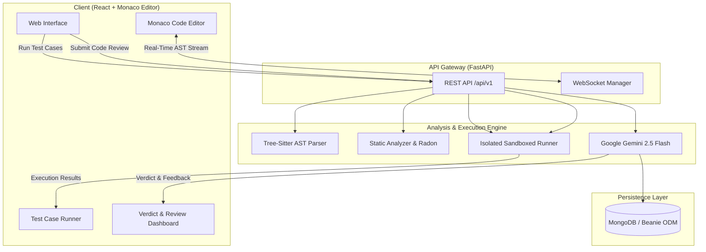

# 🚀 PyCodeReview AI: Intelligent Multi-Language Code Reviewer & Sandbox

[](https://fastapi.tiangolo.com)
[](https://ai.google.dev)
[](https://tree-sitter.github.io)
[](https://react.dev)
[](https://microsoft.github.io/monaco-editor/)
[](https://opensource.org/licenses/MIT)

**PyCodeReview AI** is an intelligent, multi-language code analysis, live AST linting, and automated test-execution platform. It pairs the power of **Google Gemini 2.5 Flash** with **Tree-Sitter AST preprocessing**, a secure **sandboxed runner**, and a modern **React + Monaco Editor** client.

---

## 🌟 Key Features

- **⚡ Real-Time AST Linting (WebSockets)**: Instant syntax checking and AST node metrics stream into the Monaco Editor as you type with sub-10ms response times.
- **🧠 Intelligent AI Code Review**: Powered by Google Gemini 2.5 Flash, providing code quality scores (0–100), algorithmic classification, and actionable bug remediation.
- **⏱️ Complexity Comparison**: Visual user vs. optimal Time and Space complexity analysis in standard Big-O notation.
- **💡 Canonical Reference Solutions**: Generates optimal reference implementations with comprehensive algorithmic explanations.
- **🛡️ Sandboxed Test Execution**: Isolated execution environment supporting Python, JavaScript, C, and C++ with strict Time Limit Exceeded (TLE) enforcement.
- **💾 Review History & Persistence**: Asynchronous submission persistence powered by MongoDB and Beanie ODM with an automated in-memory fallback.
- **🎨 Modern Dark Design System**: Premium obsidian UI built with Vanilla CSS glassmorphism, glowing status badges, and interactive feedback.

---

## 🏗️ System Architecture



---

## 🧰 Tech Stack

| Domain | Technologies |
| :--- | :--- |
| **Frontend** | React 18, Vite, Monaco Editor, Lucide Icons, Vanilla CSS |
| **Backend** | Python 3.11+, FastAPI, Uvicorn, Pydantic v2 |
| **AI / LLM** | Google Gemini 2.5 Flash (`google-genai` SDK) |
| **Code Analysis** | Tree-Sitter (Python, JS, C, C++, Java), Radon Complexity |
| **Sandbox Execution** | Asynchronous Subprocess Isolation with CPU/Time Quotas |
| **Database** | MongoDB, Motor, Beanie ODM |
| **Deployment** | Docker, Docker Compose, Nginx |

---

## 📁 Repository Structure

```text
py_codeReview/
├── backend/
│   ├── app/
│   │   ├── api/v1/         # REST endpoints (Reviews, Runner, WebSockets)
│   │   ├── core/           # Gemini client, Tree-Sitter parser, Sandbox runner
│   │   ├── models/         # MongoDB Beanie document models
│   │   ├── schemas/        # Pydantic request & response contracts
│   │   ├── utils/          # Normalizers and string diff utilities
│   │   ├── config.py       # Pydantic Settings & environment loader
│   │   └── main.py         # FastAPI application entrypoint
│   ├── tests/              # Pytest test suite (10/10 automated tests)
│   ├── Dockerfile          # Backend container specification
│   ├── requirements.txt    # Python dependencies
│   └── .env.example        # Backend environment template
│
├── frontend/
│   ├── src/
│   │   ├── components/     # Monaco Editor, TestCaseRunner, VerdictView, Navbar
│   │   ├── hooks/          # useWebSocket hook for real-time AST linting
│   │   ├── services/       # Axios API client
│   │   ├── data/           # LeetCode-style preset problems
│   │   ├── index.css       # Obsidian glassmorphic design system
│   │   └── App.jsx         # Root layout and state coordination
│   ├── Dockerfile          # Multi-stage production Nginx container
│   ├── package.json        # Frontend scripts and packages
│   └── .env.example        # Frontend environment template
│
├── docker-compose.yml      # One-command full-stack container orchestration
└── README.md               # Project documentation
```

---

## 💻 Local Setup & Quickstart

### Prerequisites
- **Python 3.11+** installed
- **Node.js 18+** & npm installed
- **Git** installed
- *(Optional)* **Docker** & **Docker Compose**
- *(Optional)* Free **Google Gemini API Key** ([Get your key here](https://aistudio.google.com/app/apikey))

---

### Method 1: Local Development

#### 1. Clone the Repository
```bash
git clone https://github.com/t-suraj21/py_codeReview.git
cd py_codeReview
```

#### 2. Backend Setup
```bash
cd backend

# Create and activate virtual environment
python3 -m venv .venv
source .venv/bin/activate  # On Windows: .venv\Scripts\activate

# Install dependencies
pip install -r requirements.txt

# Configure environment variables
cp .env.example .env
# Edit .env and add your GEMINI_API_KEY (optional: offline fallback works automatically)

# Run the backend server
uvicorn app.main:app --reload --port 8000
```
> **Backend API Docs**: Open [http://localhost:8000/docs](http://localhost:8000/docs) to view the Swagger UI.

#### 3. Frontend Setup
In a new terminal window:
```bash
cd frontend

# Install npm packages
npm install

# Configure environment variables
cp .env.example .env

# Start Vite development server
npm run dev
```
> **Web Interface**: Open [http://localhost:5173](http://localhost:5173) in your browser.

---

### Method 2: Docker Compose (All-in-One)

You can launch the entire stack (FastAPI backend, React frontend, and MongoDB) with a single command:

```bash
# Set your Gemini API key
export GEMINI_API_KEY="your_api_key_here"

# Build and start containers
docker-compose up --build
```

- **Frontend App**: [http://localhost:5173](http://localhost:5173)
- **Backend API**: [http://localhost:8000](http://localhost:8000)
- **API Swagger Docs**: [http://localhost:8000/docs](http://localhost:8000/docs)

---

## 📖 How to Use the Web Application

1. **Select a Problem**: Choose from curated algorithmic problems (e.g. *Two Sum*, *Valid Parentheses*) or select *Custom Code*.
2. **Choose Language**: Pick your target programming language (**Python**, **JavaScript**, **C++**, or **C**).
3. **Write & Edit**: Write your code in the Monaco Editor. Notice the real-time syntax error markers and loop indicators in the navbar as you type.
4. **Run Sandbox Tests**: Click **Run Tests** to verify your solution against sample and custom test cases in an isolated sandbox.
5. **Request AI Code Review**: Click **AI Code Review** to receive an in-depth analysis containing:
   - Overall Quality Score (0–100)
   - Official Verdict (*Accepted*, *Needs Improvement*, *Wrong Answer*, *TLE*)
   - Big-O Complexity comparison (User vs. Optimal Time & Space)
   - Line-by-line defects and anti-patterns
   - Canonical optimal reference implementation with one-click copy

---

## 🧪 Running Automated Tests

The backend includes a comprehensive pytest suite verifying AST parsing, sandboxed test execution, and API endpoints:

```bash
cd backend
source .venv/bin/activate
PYTHONPATH=. pytest tests -v
```

---

## 📄 License

This project is open-source and available under the [MIT License](LICENSE).
